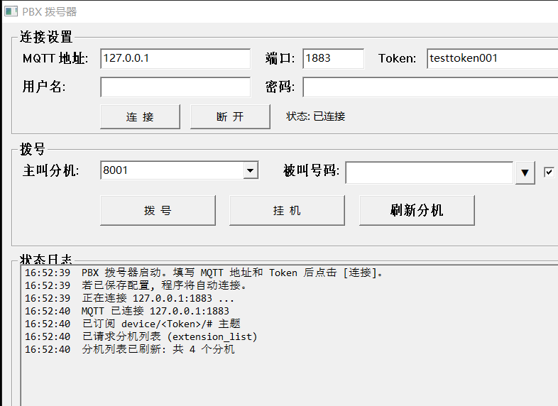
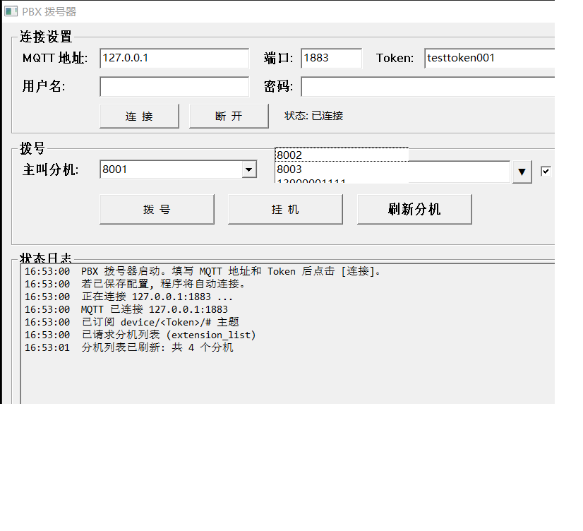
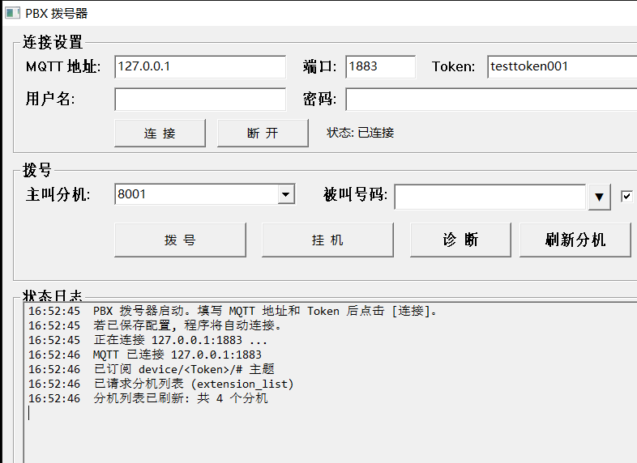

# PBX 拨号器 · pbx-dialer

> 国威 Smart PBX Manager 的 Windows 桌面拨号器 —— **单文件、免安装、离线可用**。
> 在电脑上选个分机、敲个号码、按回车，PBX 就把电话打出去。

一个 138 KB 的绿色小软件：手写 MQTT 3.1.1 直连 PBX，不依赖任何第三方库，
拷到内网机器双击就能用。适用于坐席在电脑前办公、但通话走桌面话机的场景。



## 特性

- **单文件 138 KB**：静态链接，无 VC 运行库依赖，U 盘拷过去双击即用
- **零第三方依赖**：MQTT 3.1.1 客户端（QoS0/1、keepalive、自动重连）是自己手写的
- **主叫分机实时拉取**：从 PBX 读分机列表，**只显示已注册的**（`status` 为 `Unavailable` 的隐藏），上限 2000 个，也可以直接手输号码
- **回车即拨**：被叫框回车拨号；主叫框回车时被叫有号码就拨、没号码就跳过去
- **被叫历史**：最近 12 个号码的下拉框（和主叫一样），选中即填入
- **自动接通**：勾选后对方接起即接通（`autoanswer=yes`），状态记在 ini
- **中文界面 + 中文日志**：每一步都有记录，新内容自动滚到最新，出问题看日志就知道卡在哪
- **配置全在 ini**：现场改主题/报文不用重新编译

## 下载 / 快速开始

1. 到 [Releases](../../releases) 下载：
   - `pbx-dialer-vX.Y.Z-win64.zip` —— **推荐**，解压即有 exe + 使用说明 + 兼容性说明；
   - 或单独的 `pbx-dialer.exe`（下载后改名为 `拨号.exe` 也完全一样，程序不看自己的文件名）；
2. 双击运行（首次可能被 SmartScreen 拦一下，选"更多信息 → 仍要运行"）；
3. 填 MQTT 地址、端口、Token（= 设备序列号），点【连接】；
4. 选主叫分机 → 输入被叫号码 → **回车**。

程序会在 exe 同目录生成 `pbxdialer.ini`（保存设置）和 `pbxdialer_debug.log`（收发报文），
下次启动自动连接。完整说明见 [使用说明.txt](使用说明.txt)。



## 从源码编译

只需要 MinGW-w64（gcc 14 测试通过），不需要任何第三方库：

```bat
gcc -O2 -municode -mwindows -static dialer.c -o 拨号.exe -lws2_32 -luser32 -lgdi32
```

或者直接双击 [编译.bat](编译.bat)。产物约 138 KB，`dumpbin`/`ldd` 看不到任何外部 DLL 依赖。

> 为什么不用 Qt / Electron / .NET？—— 这个工具只需要一个窗口、一个下拉框、
> 一个日志框。138 KB 的 exe 和 50 MB 的 Electron 相比，在离线内网里差距是"能拷进 U 盘"和"不能"。

## 现场排障模式

默认界面上没有【诊断】【复制日志】——用不上的人看着干净。现场要排障时，
把 `pbxdialer.ini` 里的 `show_diag` 改成 `1` 重启，两个按钮就回来了：



【诊断】发一条自定义报文（内容取 `test_topic`/`test_payload`），用来在现场试探
正确的主题和报文格式；【复制日志】把 `pbxdialer_debug.log` 拷到剪贴板，直接发给技术支持。

## 兼容性

**只支持国威（Smart PBX Manager）这一套 MQTT API**，包括国威给其他品牌做的 OEM 贴牌机。

快速判断：PBX 后台有没有「IPPBX API 接口 / MQTT 设置」，报文是不是

```json
{"cmd":"dial","request_id":"xxx","caller":"8001","callee":"8002"}
```

两条都符合就能用。Asterisk / FreePBX / 3CX / 华为 / 中兴 / Cisco 的接口完全不同，
改 ini 解决不了。详细对照表和"要支持别的品牌该怎么改"，见
[兼容性说明.md](兼容性说明.md)。

## 配置（pbxdialer.ini）

程序自动生成，记事本改完重启生效（`%s` 会替换成 Token）：

| 键 | 说明 |
|---|---|
| `host` / `port` / `user` / `pass` / `token` | MQTT 连接信息 |
| `caller` | 上次用的主叫分机（程序自动写） |
| `callee_history` | 被叫历史，`\|` 分隔，最近的在前 |
| `autoanswer` | 拨号是否自动接通，1/0（默认 1） |
| `show_diag` | 是否显示【诊断】【复制日志】按钮，1/0（默认 0） |
| `only_registered` | 主叫下拉框只列已注册分机，1/0（默认 1） |
| `topic_system` / `topic_call` | 命令主题模板，默认 `device/%s/api/v1.0/command/{system,call}` |
| `sub_extra` | 额外订阅主题，`;` 分隔（默认已订阅 `device/%s/#`） |
| `dial_extra` | 拨号报文追加片段，如 `"dialpermission":"8001"` |
| `test_topic` / `test_payload` | 【诊断】按钮发的主题和内容 |
| `cmd_qos` | 命令用 QoS1（默认）还是 QoS0 |

## 项目结构

```
dialer.c           主程序（单文件，约 1900 行 C）
编译.bat           一键编译
使用说明.txt        面向使用者的中文说明
兼容性说明.md       支持哪些 PBX、怎么适配别的品牌
docs/              截图与开发记录
test/              端到端测试（本地 broker + 模拟 PBX，无需真机）
```

## 测试

`test/` 下是端到端测试：用本地 amqtt broker + 一个模拟 PBX（paho-mqtt）把
"连接 → 拉分机 → 拨号 → 响应 → 挂机"整条链路跑通，**不需要真机**。

```
python run_broker.py          # 起 broker（127.0.0.1:1883）
python fake_pbx.py            # 起模拟 PBX
python e2e_ui.py <exe路径>     # 界面 / 回车 / 双击历史
```

当前 **75 项全部通过**：dial 9 + caller 14 + extlist 10 + ini 5 + diag 5 + autoanswer 12 + ui 20。
详见 [test/README.txt](test/README.txt)。

## 已知限制

- 只实现了国威这套 API；换 PBX 需要改代码（见兼容性说明）
- 单实例运行（防止同一台机器重复拨号）
- 分机下拉框最多显示 2000 个，超出时仍可手输号码
- 界面按 96 DPI 设计，高 DPI 下按比例缩放

## License

[MIT](LICENSE)